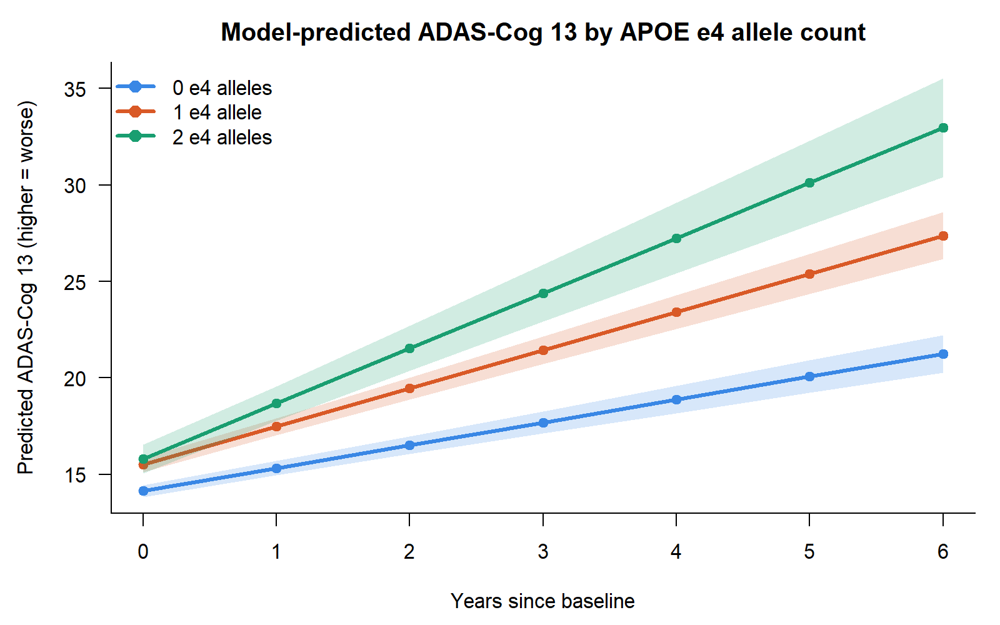
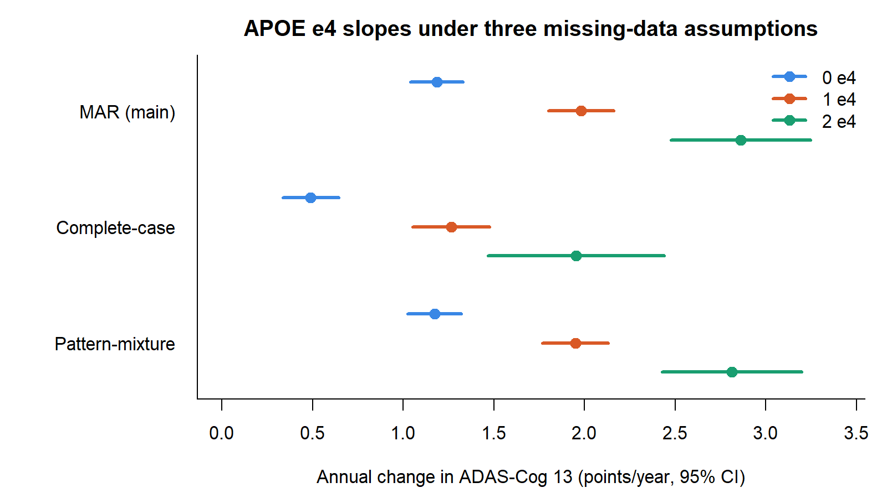

# APOE ε4 and the Rate of Cognitive Decline in ADNI

Longitudinal mixed-effects analysis of ADAS-Cog 13 in the Alzheimer's Disease Neuroimaging Initiative (ADNI), with
missing-data sensitivity analyses and submission-style tables, listings and figures (TLFs) validated by independent
double programming in R.

**Tools:** SAS (DATA step, Macro, PROC MIXED, PROC GLIMMIX, PROC LOGISTIC, PROC REPORT, ODS RTF/PDF, PROC SGPLOT) ·
R (base, nlme) · Stata · CDISC ADaM

## Key results

**2,830 participants, 8,782 visits**, followed up to 6 years across the ADNI1, ADNIGO, ADNI2, ADNI3 and ADNI4 protocols.

| APOE ε4 alleles | N | Annual change in ADAS-Cog 13 (95% CI) |
|---|---|---|
| 0 | 1,551 | 1.18 (1.04, 1.33) |
| 1 | 1,013 | 1.98 (1.80, 2.16) |
| 2 | 266 | 2.86 (2.48, 3.25) |

- Decline is about **2.4× faster in ε4 homozygotes** than in non-carriers (difference 1.68 points/year, p < 0.001).
- Missingness depends on the last observed score (LR χ² = 96.6), which supports a MAR assumption. Separating
  administrative censoring from true dropout matters here: 56% of ε4 homozygotes dropped out by year 2, vs. 39% of
  non-carriers.
- The APOE ε4 dose-response holds under complete-case and pattern-mixture (MNAR) sensitivity analyses.




## Pipeline

| Step | Program | What it does |
|---|---|---|
| 1 | [`R/extract_adni.R`](R/extract_adni.R) | Builds an analysis file from the ADNIMERGE2 ADaM datasets (ADSL, ADQS) and maps irregular visits to nominal annual years (±0.35-year window) |
| 2 | [`sas/adni_longitudinal.sas`](sas/adni_longitudinal.sas) | Reshapes wide to long with DATA-step arrays, assesses the missing-data mechanism (logistic and GLIMMIX models), selects the random-effects structure by LR test, fits the final REML model (random intercept and slope, unstructured G) with macro-generated ESTIMATE statements, then runs a binomial GLMM for MMSE and the complete-case and pattern-mixture sensitivity models |
| 3 | [`sas/adni_tlf.sas`](sas/adni_tlf.sas) | Builds ADSL- and BDS-style datasets and produces TLFs with PROC REPORT and ODS RTF/PDF |
| 4 | [`R/adni_tlf_qc.R`](R/adni_tlf_qc.R) | Independent QC: re-derives every table from the source CSV in base R and compares each cell with the SAS output |
| – | [`stata/adni_longitudinal.do`](stata/adni_longitudinal.do) | Stata replication of step 2 |

### TLFs produced

| Output | Title |
|---|---|
| Table 14.1.1 | Demographics and baseline characteristics by APOE ε4 allele count |
| Table 14.1.2 | Participant disposition and visit retention |
| Table 14.2.1 | ADAS-Cog 13 observed values and change from baseline by visit |
| Table 14.2.2 | Annual rate of change: main and missing-data sensitivity models |
| Figure 14.2.1–14.2.3 | Mean change from baseline, model-predicted trajectories, forest plot of slope differences |
| Listing 16.2.1 | Discontinued participants with two APOE ε4 alleles |

Aggregate table outputs are in [`results/tlf/`](results/tlf/) and model estimates in [`results/model/`](results/model/).

### Validation

Double programming in R agreed with SAS on **every cell** of Tables 14.1.1, 14.1.2 and 14.2.1 and on all 202 rows of
Listing 16.2.1. The model estimates were also reproduced in R (nlme).

```
t1411  MATCH (0 issues)
t1412  MATCH (0 issues)
t1421  MATCH (0 issues)
l1621  MATCH (SAS 202 rows, R 202 rows)
```


## Acknowledgment

Data used in this project were obtained from the Alzheimer's Disease Neuroimaging Initiative (ADNI) database
(adni.loni.usc.edu). The ADNI investigators contributed to the design and implementation of ADNI and/or provided data
but did not participate in this analysis or writing.

---
Marko Tyhansky · [LinkedIn](https://www.linkedin.com/in/marko-tyhansky/)
